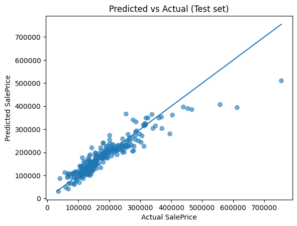
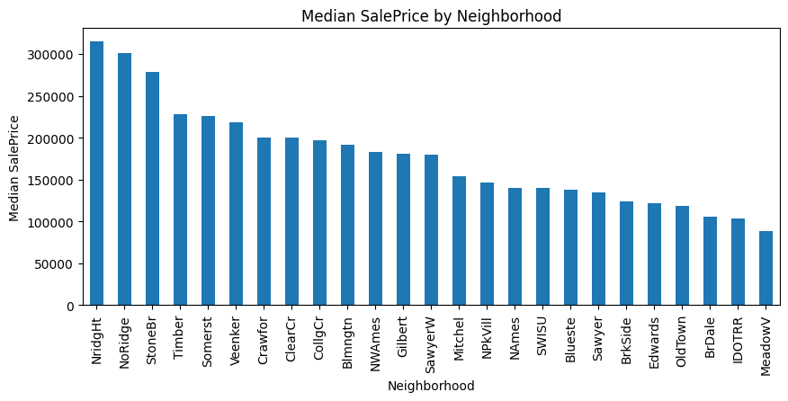

# house-price-regression

Predicting house sale prices from 79 property features (Ames, Iowa housing dataset, 1,460 houses).
A regularized linear model with degree-2 interaction features explains **88% of price variance**
(R² 0.879), cutting test RMSE by 9.5% compared with the plain ElasticNet baseline.



*DAN.IT Data Science course, machine learning homework.*

## Results

Held-out test set: 292 houses (20%).

| Model | RMSE ($) | MAE ($) | R² | RMSLE |
|---|---|---|---|---|
| ElasticNet (baseline) | 33,632 | 20,763 | 0.853 | 0.166 |
| **ElasticNet + polynomial features (degree 2)** | **30,431** | **19,165** | **0.879** | **0.166** |

## Approach

- **EDA:** right-skewed target; strongest drivers are overall quality (r = 0.79), living area (0.71)
  and garage size. Neighborhood and kitchen quality show large median price differences.
- **Preprocessing:** scikit-learn `ColumnTransformer`. Numeric features get median imputation and
  standard scaling; categorical features get mode imputation and one-hot encoding.
- **Model:** ElasticNet (combined L1 + L2 regularization), with `alpha` and `l1_ratio` tuned by 5-fold
  grid search (100 configurations).
- **Extension:** degree-2 polynomial features, letting the linear model capture interactions
  such as quality × size.



## How to run

```bash
git clone https://github.com/dariaproniakova/house-price-regression.git
cd house-price-regression
pip install -r requirements.txt
# put train.csv in data/ (see data/README.md)
jupyter lab notebooks/
```

## What I learned / limitations

- Feature interactions gave a bigger gain than further tuning of the regularization strength.
- The model **underpredicts the most expensive houses** (above ~$450k, see the plot): there are few
  examples and the price is skewed. Training on log(price), or using a tree-based model, would likely help.
- Results come from a single train/test split on a small dataset.

## License

Code: MIT. The dataset is not included in this repository.
